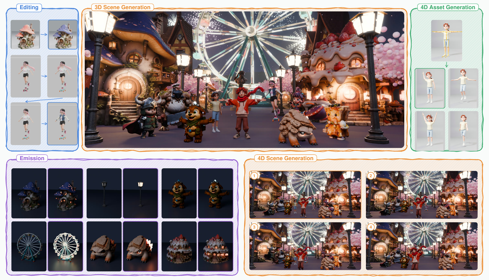
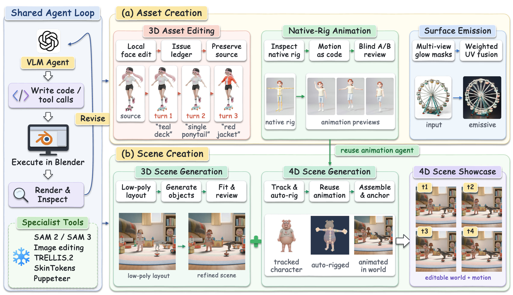

# WorldSmith: Unified Agentic 3D and 4D Content Creation

**One agent, infinite worlds.**

[Project page](https://gkgo14.github.io/worldsmith/) · Paper (coming soon) · arXiv (coming soon)

> [!IMPORTANT]
> **This is a preview release, not the full code.** It contains the algorithmic components of WorldSmith (Eqs. 1–4
> and the agent's own checks, implemented in NumPy and unit-tested) and a **pseudocode-level outline** of the agent
> loop and the five task pipelines. The model backends, benchmark loaders and evaluation code are not included, so
> this repository **cannot reproduce the generation results or the numbers in the paper**.
>
> **The full implementation will be released as soon as possible.**



WorldSmith is one vision-language agent that writes Blender Python, renders its own result, looks at it and revises
until it matches the goal. The same loop serves five 3D and 4D creation tasks, with no task-specific training.

This preview shows how the method (Sec. 3 of the paper) is put together: the shared agent loop, the five task
harnesses and the numerical parts behind Eqs. 1–4. Only the numerical parts and the checks run on their own; the
pipelines are outlines of the steps. See [What is in this release](#what-is-in-this-release) for the exact state of
each part.

## The five tasks

| Task | `run(...)` name | Input → output | Code |
|---|---|---|---|
| 3D asset editing | `edit` | mesh + instruction (+ image) → edited mesh, turn after turn | [editing.py](worldsmith/editing.py) |
| Surface emission | `emission` | mesh + base colour + thumbnail → emission map on the texture atlas | [emission.py](worldsmith/emission.py) |
| Rig-based animation | `animate` | rigged mesh + video → keyframed bone and armature motion | [animation.py](worldsmith/animation.py) |
| 3D scene generation | `scene3d` | one image + camera → instance-level objects on the ground plane | [scene3d.py](worldsmith/scene3d.py) |
| 4D scene generation | `scene4d` | monocular video + camera → instance-level animated scene | [scene4d.py](worldsmith/scene4d.py) |



The loop is shared ([agent.py](worldsmith/agent.py)). Each task plugs in a *harness*: its prompt, the tools the model
may call, the state the host keeps, and the check at delivery. The agent never sees ground-truth geometry, motion or
evaluation scores. It only sees the task inputs and renders or measurements of its own candidates.

| Task | What the harness adds |
|---|---|
| Editing | Edit scope, issue ledger, evidence bound to the candidate that produced it, source-preservation gate |
| Emission | Per-view masks (SAM 3 text, SAM 2 points/boxes or CIE76 colour selection), reliability-weighted UV fusion (Eq. 2) |
| Animation | Rig description, motion written as keyframes, immutable candidates, blind A/B review of at least four (Eq. 1) |
| 3D scene | Low-poly layout first, reference crop and completion gate, one mesh per object, silhouette fit, review |
| 4D scene | 3D scene of frame 1, motion score (Eq. 3), tracking, auto-rig, the animation harness reused, Umeyama anchor (Eq. 4) |

## Install

Python 3.10 or newer. The only dependency is NumPy.

```bash
pip install -e .            # run inside the cloned repository
pip install -e ".[dev]"     # also installs pytest
```

## Try it

The numerical parts run on their own:

```python
import numpy as np
from worldsmith.scene4d import umeyama
from worldsmith.emission import select_colors

# Eq. 4: one similarity transform that maps the posed first frame back onto the rest shape
rest = np.random.default_rng(0).normal(size=(500, 3))
posed = 0.5 * rest[:, [1, 0, 2]] * [1, -1, 1] + [2.0, 0.0, 1.0]     # rotated 90 degrees, half size, shifted
A = umeyama(posed, rest)
print(np.abs((np.c_[posed, np.ones(500)] @ A.T)[:, :3] - rest).max())   # about 1e-15

# CIE76 selection (tau_c = 15): the pixels close to a sampled colour
image = np.zeros((4, 4, 3), np.uint8); image[:2] = (255, 200, 60)
print(select_colors(image, np.ones((4, 4), bool), [(250, 205, 70)]).sum())   # 8
```

To watch the agent loop without any model or Blender, run the editing harness with stand-in backends:

```bash
python examples/mock_edit_run.py
```

A scripted "model" replays six tool calls. The output shows the host refusing an issue that cites evidence it never
registered, an assessment going out of date when the asset changes, and the source-preservation gate failing a
delivery in which a protected object moved.

## Interface of the full system

This section describes the interface the full release will use. **In this preview the pipelines do not run end to
end**: no backends are provided, `scene3d` and `scene4d` are pseudocode, and the `edit`, `emission` and `animate`
outlines have only been run against stand-in backends in the tests.

`WorldSmith.run(task, **inputs)` is the single entry point:

```python
from worldsmith import WorldSmith, Toolbox

toolbox = Toolbox(vlm=..., blender=..., segmenter=..., image_editor=..., matting=..., mesh_generator=..., rigger=...)
ws = WorldSmith(toolbox, root="runs")
ws.run("edit",     previous_output=..., instruction=..., condition_image=..., camera=...)
ws.run("emission", mesh=..., base_color=..., thumbnail=...)
ws.run("animate",  rigged=..., video=...)
ws.run("scene3d",  image=..., camera=...)
ws.run("scene4d",  video=..., camera=...)     # scene3d(frame 1) + track + auto-rig + animate + anchor
```

You supply the `Toolbox`. [tools.py](worldsmith/tools.py) defines one interface per tool; the paper uses these models:

| Interface | Role | Model in the paper |
|---|---|---|
| `VLM` | Plans, writes Blender Python, calls tools | GPT-6 Astra / GPT-6.1 Sol |
| `BlenderExecutor` | Runs agent-written scripts, renders, exports | Blender (bpy) |
| `Segmenter` | Masks from text, points or boxes; video tracking | SAM 2 / SAM 3 |
| `ImageEditor` | Completes an occluded object crop | gpt-image-2 |
| `Matting` | Foreground mask | BiRefNet |
| `MeshGenerator` | Image to 3D | TRELLIS.2 |
| `Rigger` | Skeleton and skinning weights | SkinTokens + Puppeteer |

A tool that a task does not need can be left out; it is then not offered to the model.

## What is in this release

| Part | State |
|---|---|
| Eq. 1 `linear_blend_skinning`; Eq. 2 `atlas_weights`, `fuse_views`, `emission_map`; Eq. 3 `motion_scores`; Eq. 4 `umeyama` | Runs (NumPy), tested |
| `select_colors` (CIE76, tau_c = 15), `ground_point`, `reference_crop_box`, `fill_occluded`, `accept_completion` (IoU ≥ 0.55), `fit_to_proxy`, `first_frame_mask`, `union_crop_box`, `canonical_transform` | Runs (NumPy), tested |
| `IssueLedger`, `EditState`, `source_preservation_gate`, `CandidatePool` (at least 4 candidates, blind A/B review) | Runs (Python), tested |
| `AgentLoop` and the harnesses for `edit`, `emission`, `animate` | Pseudocode-level outline. Runs only with stand-in backends (see the tests and the example) |
| `scene3d.run`, `scene4d.run` | Pseudocode. They show the order of the steps; the helpers they call are stubs, so they do not run |
| Model backends, benchmark loaders, evaluation code | Not included; coming with the full release |

Places where the outline stops short of a full implementation:

- **Emission**: `fuse_and_apply` is a placeholder. The host step it stands for is `atlas_weights` per view, then
  `fuse_views`, then `emission_map`, then export.
- **Animation**: the delivery check (every frame compared in Blender and in the exported GLB) always reports a pass
  in this preview, and the candidate previews for the reviewer are placeholders.
- **Editing**: the delivery gate reads source and delivered vertices from the task inputs. Face localisation,
  deletion, repair and retexturing are written by the agent in Blender Python and are not reproduced here.
- **3D scene**: the image and Blender helpers at the end of `scene3d.py` are stubs.
- **4D scene**: `scene4d.run` expects prepared inputs (`first_frame`, `frames`, `frame1_labels`, `object_names`,
  `character_vertices_world`, `camera_to_world`) in place of the raw video.

All of these will be replaced by the working implementation in the full release.

## Tests

```bash
pytest
```

45 tests cover the four equations, the geometric helpers, the editing ledger and gate, the candidate pool, and the
agent loop driven by a scripted model.

## Repository layout

```
worldsmith/
  agent.py      shared loop and the unified entry WorldSmith.run(task, **inputs)
  tools.py      interfaces of the tools the agent calls
  editing.py    Sec. 3.1  3D asset editing
  animation.py  Sec. 3.2  rig-based animation   (Eq. 1)
  emission.py   Sec. 3.3  surface emission      (Eq. 2)
  scene3d.py    Sec. 3.4  3D scene generation
  scene4d.py    Sec. 3.5  4D scene generation   (Eqs. 3-4)
examples/       mock_edit_run.py
tests/          pytest suite
assets/         figures used in this README
docs/           source of the project page (served by GitHub Pages)
```

## Citation

```bibtex
@article{worldsmith2026,
  title  = {WorldSmith: Unified Agentic 3D and 4D Content Creation},
  year   = {2026}
}
```

## License

Released under the [MIT License](LICENSE).
